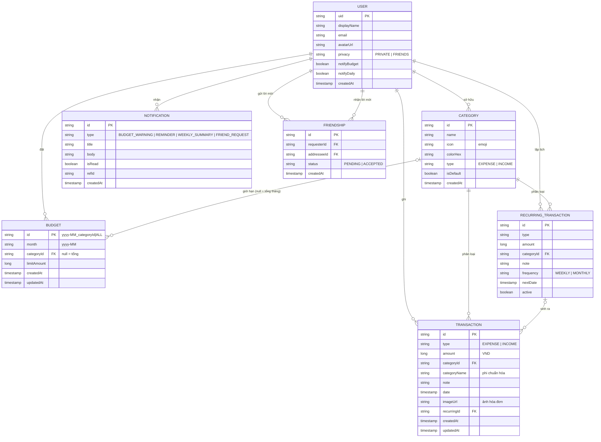
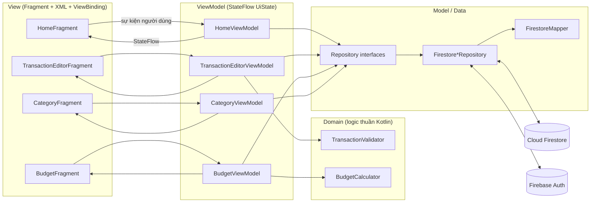
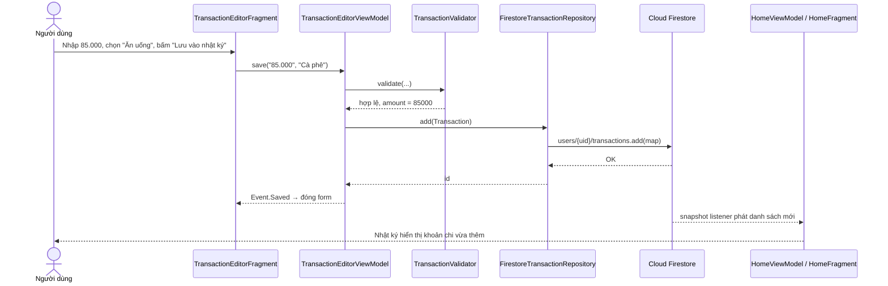

# Tuần 3 – Cơ sở dữ liệu và kiến trúc ứng dụng

**Đề tài:** Tiu – Ứng dụng quản lý chi tiêu cho sinh viên trên nền tảng Android
**Công nghệ:** Kotlin · XML Views · MVVM · Firebase Authentication · Cloud Firestore

---

## 1. Lựa chọn cách lưu trữ dữ liệu

| Tiêu chí | SQLite / Room (cục bộ) | **Firebase Firestore (trực tuyến) – chọn** |
|---|---|---|
| Đồng bộ nhiều thiết bị | Không có sẵn | Có, theo tài khoản |
| Cập nhật realtime lên giao diện | Phải tự cài đặt | Snapshot listener có sẵn |
| Hoạt động khi mất mạng | Có | Có (offline cache bật mặc định) |
| Tính năng bạn bè / chia sẻ nhật ký (Figma: "Bạn bè trên tiu") | Không làm được | Làm được (collection `friendships`) |
| Lưu ảnh hóa đơn (Tuần 4, phần của Hoài) | Lưu file trên máy | Firebase Storage, cùng hệ sinh thái |
| Bảo mật | Dữ liệu nằm trên máy | Security Rules theo `uid` |
| Sao lưu (yêu cầu 1.8.9) | Tự làm | Dữ liệu nằm trên cloud |

**Kết luận:** dùng **Cloud Firestore** làm nguồn dữ liệu chính, **Firebase Authentication** (email/mật khẩu) để định danh người dùng. Firestore đã tự cache dữ liệu cục bộ nên ứng dụng vẫn xem được khi mất mạng. Vì tầng ViewModel chỉ làm việc với *interface* Repository, sau này có thể thêm Room mà không phải sửa giao diện.

---

## 2. Mô hình dữ liệu (ERD)



### 2.1. Mô tả các bảng

| Bảng | Ý nghĩa | Chức năng sử dụng (theo mô tả đề tài) |
|---|---|---|
| **USER** | Hồ sơ người dùng, cài đặt riêng tư & thông báo | 1. Quản lý tài khoản, Tài khoản (Figma) |
| **CATEGORY** | Danh mục thu/chi; 10 danh mục mặc định được tạo khi đăng ký | 2. Quản lý giao dịch |
| **TRANSACTION** | Một khoản thu hoặc chi | 2. Giao dịch, 3. Chi tiêu bằng hình ảnh, 5. Thống kê |
| **BUDGET** | Hạn mức chi theo tháng – tổng hoặc theo danh mục | 4. Quản lý ngân sách, cảnh báo vượt mức |
| **NOTIFICATION** | Hộp thư: cảnh báo ngân sách, nhắc ghi chép, tổng kết tuần, lời mời kết bạn | 1.8.4 Thông báo nhắc nhở |
| **RECURRING_TRANSACTION** | Mẫu giao dịch lặp lại (tiền trọ, internet, thu nhập) | 1.8.8 Giao dịch định kỳ |
| **FRIENDSHIP** | Quan hệ bạn bè n–n giữa các USER | Bạn bè / quyền riêng tư (Figma) |

### 2.2. Các quan hệ

| Quan hệ | Bản số | Cách thể hiện trong Firestore |
|---|---|---|
| USER – CATEGORY / TRANSACTION / BUDGET / NOTIFICATION / RECURRING | 1 – n | Sub-collection dưới `users/{uid}` |
| CATEGORY – TRANSACTION | 1 – n | Trường `transaction.categoryId` |
| CATEGORY – BUDGET | 0..1 – n | `budget.categoryId` (null = ngân sách tổng tháng) |
| RECURRING_TRANSACTION – TRANSACTION | 0..1 – n | `transaction.recurringId` |
| USER – USER (bạn bè) | n – n | Bảng trung gian `friendships` với `requesterId`, `addresseeId` |

### 2.3. Ràng buộc dữ liệu

- `amount > 0`, tối đa 1.000.000.000 ₫; `type ∈ {EXPENSE, INCOME}`; ghi chú ≤ 200 ký tự; không chọn ngày trong tương lai (kiểm tra ở `TransactionValidator` **và** `firestore.rules`).
- Tên danh mục 1–30 ký tự, **không trùng** trong cùng loại.
- **Không xóa danh mục đang được giao dịch tham chiếu** (giữ toàn vẹn quan hệ CATEGORY 1–n TRANSACTION).
- Mỗi tháng chỉ có **một** ngân sách cho mỗi danh mục: id tài liệu cố định `yyyy-MM_categoryId` (hoặc `yyyy-MM_ALL`), nên ghi lại chỉ là cập nhật.
- Số tiền lưu kiểu số nguyên (đồng), không dùng số thực để tránh sai số làm tròn.

---

## 3. Ánh xạ ERD → Firestore

Firestore là CSDL NoSQL dạng *document*: thay vì bảng/khóa ngoại, dữ liệu của mỗi người nằm dưới document của họ.

```text
users/{uid}                              ← USER
 ├─ categories/{categoryId}              ← CATEGORY
 ├─ transactions/{transactionId}         ← TRANSACTION
 ├─ budgets/{yyyy-MM}_{categoryId|ALL}   ← BUDGET
 ├─ notifications/{notificationId}       ← NOTIFICATION      (tuần 4–5)
 └─ recurring/{recurringId}              ← RECURRING_TRANSACTION (tuần 5)
friendships/{friendshipId}               ← FRIENDSHIP (dùng chung cho 2 người)
```

**Phi chuẩn hóa có chủ đích:** `transaction.categoryName` được lưu kèm để màn Nhật ký hiển thị mà không cần "join" (Firestore không có JOIN). Khi đổi tên danh mục, `FirestoreCategoryRepository.update()` dùng một **WriteBatch** để cập nhật luôn tên trong các giao dịch liên quan.

**Truy vấn chính & index:**

| Màn hình | Truy vấn | Index |
|---|---|---|
| Nhật ký, Ngân sách | `transactions` where `date` ∈ [đầu tháng, đầu tháng sau) orderBy `date` desc | Index đơn tự động |
| Ngân sách | `budgets` where `month == "2025-06"` | Index đơn tự động |
| Xóa danh mục | `transactions` where `categoryId == x` limit 1 | Index đơn tự động |
| Thống kê theo danh mục (tuần 4) | `categoryId ==` + orderBy `date` | Composite – khai báo trong `firestore.indexes.json` |

**Bảo mật:** `firestore.rules` chỉ cho người dùng đọc/ghi `users/{uid}/**` của chính mình và kiểm tra kiểu dữ liệu khi ghi.

---

## 4. Kiến trúc ứng dụng – MVVM



| Tầng | Trách nhiệm | Lớp tiêu biểu |
|---|---|---|
| **View** | Hiển thị `UiState`, chuyển thao tác người dùng cho ViewModel. Không chứa logic nghiệp vụ. | `HomeFragment`, `TransactionEditorFragment`, adapter RecyclerView |
| **ViewModel** | Giữ trạng thái màn hình (sống qua xoay màn hình), gọi Repository trong `viewModelScope`, phát sự kiện một lần (Saved, Deleted, thông báo lỗi). | `TransactionEditorViewModel`, `BudgetViewModel` |
| **Domain** | Quy tắc nghiệp vụ thuần Kotlin, dễ unit test: kiểm tra dữ liệu nhập, tính % ngân sách, hạn mức mỗi ngày. | `TransactionValidator`, `BudgetCalculator` |
| **Model / Data** | Interface Repository + bản cài đặt Firestore; ánh xạ document ↔ data class. | `TransactionRepository`, `FirestoreTransactionRepository`, `FirestoreMapper` |

**Các quyết định:**
- **Single-Activity + Navigation Component**: `MainActivity` chứa `NavHostFragment` và thanh điều hướng dưới 5 mục như Figma.
- **Dependency Injection thủ công** (`AppContainer`): một nơi duy nhất tạo Repository; ViewModel nhận Repository qua constructor ⇒ khi test thay bằng `FakeRepository`.
- **Luồng dữ liệu một chiều:** Firestore → `Flow` (snapshot listener) → `StateFlow<UiState>` → View. Ghi dữ liệu xong không cần tải lại thủ công: listener tự đẩy dữ liệu mới lên giao diện.

---

## 5. Cấu trúc thư mục

```text
Tiu/
├─ app/src/main/java/vn/edu/dut/tiu/
│  ├─ TiuApp.kt                    Application, khởi tạo AppContainer
│  ├─ di/AppContainer.kt           DI thủ công
│  ├─ data/
│  │  ├─ model/                    Entities.kt (7 thực thể ERD), Enums.kt
│  │  ├─ remote/                   FirestorePaths.kt, FirestoreMapper.kt
│  │  └─ repository/               Repositories.kt (interface), FirebaseAuthRepository.kt,
│  │                               FirestoreRepositories.kt (Category/Transaction/Budget)
│  ├─ domain/                      TransactionValidator.kt, BudgetCalculator.kt
│  ├─ ui/
│  │  ├─ MainActivity.kt
│  │  ├─ auth/                     Đăng nhập, Đăng ký
│  │  ├─ home/                     Nhật ký (danh sách giao dịch theo ngày)
│  │  ├─ transaction/              Form Thêm / Sửa / Xóa giao dịch
│  │  ├─ budget/                   Ngân sách tháng & theo danh mục
│  │  ├─ category/                 Quản lý danh mục
│  │  ├─ account/                  Tài khoản, đăng xuất
│  │  └─ common/                   Tiện ích UI, màn tạm (Thống kê, Chụp ảnh)
│  └─ util/                        MoneyFormat.kt, DateUtils.kt
├─ app/src/main/res/               layout/, navigation/nav_graph.xml, menu/, drawable/ (style doodle), values/
├─ app/src/test/                   Unit test (JUnit + kotlinx-coroutines-test)
├─ docs/Tuan3_CSDL_KienTruc.md     Báo cáo này
├─ firestore.rules                 Security Rules
├─ firestore.indexes.json          Index Firestore
└─ firebase.json                   Cấu hình deploy rules/index
```

---

## 6. Thao tác Thêm / Sửa / Xóa dữ liệu cơ bản (CRUD)

| Thực thể | Create | Read | Update | Delete |
|---|---|---|---|---|
| **Giao dịch** | Nút **+** → form "Thêm khoản chi" | Màn **Nhật ký**: nhóm theo ngày, tổng Chi/Thu/Số dư, chuyển tháng | Chạm vào giao dịch → sửa | Nhấn giữ giao dịch, hoặc nút "Xóa giao dịch" trong form (có hộp xác nhận) |
| **Danh mục** | Tài khoản → Quản lý danh mục → "+ Thêm danh mục" | Danh sách theo Chi tiêu / Thu nhập | Chạm → đổi tên/biểu tượng (cập nhật luôn tên trong giao dịch) | Nhấn giữ; bị chặn nếu đang được dùng |
| **Ngân sách** | Chạm thẻ % (tổng tháng) hoặc "+ Tạo ngân sách danh mục" | Màn **Ngân sách**: % đã dùng, hạn mức mỗi ngày, tiến độ từng danh mục | Chạm thẻ → sửa hạn mức | Nút "Xóa ngân sách" trong hộp thoại |
| **Người dùng** | Đăng ký (tạo `users/{uid}` + 10 danh mục mặc định trong 1 WriteBatch) | Trang Tài khoản | (tuần 4) | Đăng xuất |

### Luồng minh họa: Thêm một khoản chi



---

## 7. Kiểm thử

Chạy: `gradlew testDebugUnitTest` — **19 test, tất cả đạt**.

| Lớp test | Nội dung |
|---|---|
| `MoneyFormatTest` | Định dạng `85.000 ₫`, dấu +/−, đọc số tiền người dùng nhập |
| `TransactionValidatorTest` | Thiếu số tiền/danh mục, số tiền 0 hoặc quá lớn, ghi chú quá dài, ngày tương lai |
| `BudgetCalculatorTest` | Tổng thu/chi, % đã dùng, trạng thái OK/cảnh báo ≥ 80%/vượt, số ngày còn lại, hạn mức mỗi ngày |
| `TransactionEditorViewModelTest` | Thêm, kiểm tra dữ liệu sai, đổi loại thu/chi, sửa (giữ `createdAt`), xóa – dùng Fake Repository |
| `HomeGroupingTest` | Nhóm giao dịch theo ngày, nhãn "Hôm nay/Hôm qua", tổng ròng mỗi ngày |
| `BudgetStateTest` | Ghép ngân sách + giao dịch + danh mục thành trạng thái màn Ngân sách |
| `CategoryValidationTest` | Tên rỗng, quá dài, trùng tên cùng loại |

## 8. Việc chuyển sang tuần sau

- Tuần 4: Thống kê + biểu đồ (MPAndroidChart) dùng index `categoryId + date`; cảnh báo vượt ngân sách ghi vào `notifications`.
- Chụp ảnh (CameraX), tải lên Storage, gán `transaction.imageUrl`; OCR ML Kit.
- Giao dịch định kỳ (`recurring`) và bạn bè (`friendships`) đã có trong ERD và Security Rules.
